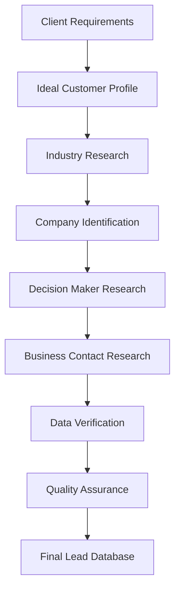

<div align="center">

# B2B Lead Generation

### Prospect Research | Targeted List Building | Data Intelligence

**Research. Identify. Verify. Connect.**

Developed by Sree Polash Kumar Das  
Co-Founder & COO — Synthetic Alliance

---

[](https://polashkumar.sites.bd/)
[](https://www.linkedin.com/in/sree-polash-kumar-das/)

</div>

---

## 01. Project Overview

This repository is a professional portfolio dedicated to B2B lead generation, prospect research, targeted list building, and business data management.

Its objective is to demonstrate structured research methodologies for identifying relevant businesses and decision-makers based on specific client requirements.

## 02. Core Capabilities

| Service | Description |
|---|---|
| B2B Lead Generation | Targeted business prospect identification |
| Prospect Research | Company and decision-maker research |
| List Building | Customized prospect databases |
| ICP Development | Ideal customer profile research |
| Contact Research | Professional business contact identification |
| Data Enrichment | Improving business data completeness |
| Email Verification | Email validation and quality assessment |
| Data Cleaning | Duplicate removal and standardization |

## 03. Target Industries

- SaaS & Technology
- Digital Marketing Agencies
- E-commerce
- Real Estate
- Professional Services
- Healthcare Businesses
- Small & Medium Enterprises
- B2B Service Providers

## 04. Lead Generation Methodology



## 05. Lead Database Structure

| Field | Description |
|---|---|
| Company Name | Official business name |
| Website | Company website |
| Industry | Business category |
| Company Size | Employee range |
| Location | Geographic market |
| First Name | Prospect first name |
| Last Name | Prospect last name |
| Job Title | Professional designation |
| LinkedIn URL | Professional profile |
| Business Email | Business contact email |
| Verification Status | Email validation status |
| Source | Research reference |
| Research Date | Date of data collection |

## 06. Quality Assurance Standards

- ICP relevance assessment
- Company information validation
- Decision-maker relevance
- Business email verification
- Duplicate removal
- Consistent data formatting
- Source documentation
- Data privacy awareness

## 07. Research Tools & Technologies

### Research Resources

`LinkedIn` `Google Search` `Company Websites`

### Lead Generation Technologies

`Apollo.io` `Hunter.io` `Snov.io`

### Data Management

`Microsoft Excel` `Google Sheets` `CSV` `Python`

These are relevant tools for lead generation workflows. Their inclusion does not imply certification or paid subscription access.


## 08. Portfolio Resources

Explore the following resources to understand my
B2B lead generation approach, research methodology,
and data quality management framework.

| Resource | Description | Access |
|---|---|---|
| Sample Lead Database | Structured demonstration dataset | [View Dataset](samples/b2b-sample-leads.csv) |
| ICP Template | Ideal customer profile development | [View Template](templates/ideal-customer-profile.md) |
| Quality Assurance | Data validation and quality standards | [View Framework](templates/quality-assurance-checklist.md) |
| SaaS Case Study | End-to-end lead generation strategy | [View Case Study](case-studies/saas-lead-generation.md) |

### Repository Structure

```text
b2b-lead-generation/
├── README.md
├── samples/
│   └── b2b-sample-leads.csv
├── templates/
│   ├── ideal-customer-profile.md
│   └── quality-assurance-checklist.md
└── case-studies/
    └── saas-lead-generation.md
```

### Development Status

- [x] Professional documentation
- [x] Lead generation methodology
- [x] Database structure
- [x] Demonstration lead database
- [x] Ideal customer profile template
- [x] Quality assurance framework
- [x] SaaS demonstration case study

### Future Development

- [ ] Additional industry-specific case studies
- [ ] Expanded research datasets
- [ ] Data processing and automation tools

All current datasets and case studies are demonstration
resources, not verified client project results.


## 09. Privacy & Transparency

All demonstration datasets will be clearly labeled as sample data.

Confidential client information, private contact details, account credentials, and sensitive business records will not be published.

Research activities should respect applicable privacy laws and platform terms.

## 10. About Synthetic Alliance

Synthetic Alliance is a digital marketing agency focused on strategic business growth.

### Core Services

- Social Media Marketing
- B2B Lead Generation
- Email Marketing

> YOUR GROWTH IS OUR PURPOSE.

## 11. Professional Contact

**Sree Polash Kumar Das**  
B2B Lead Generation Specialist  
Co-Founder & Chief Operating Officer  
Synthetic Alliance

- [Professional Portfolio](https://polashkumar.sites.bd/)
- [LinkedIn Profile](https://www.linkedin.com/in/sree-polash-kumar-das/)
- [GitHub Profile](https://github.com/sree-polash-das)

---

<div align="center">

**Precision in Research. Purpose in Every Connection.**

SYNTHETIC ALLIANCE

**YOUR GROWTH IS OUR PURPOSE.**

</div>
