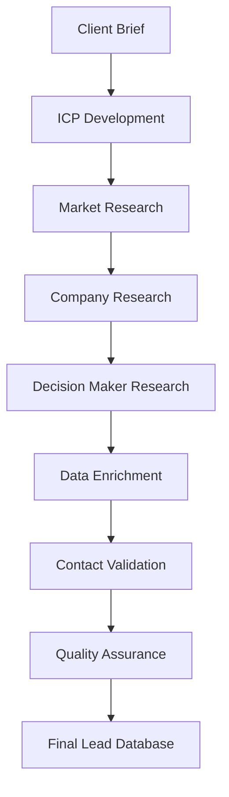

# B2B Lead Generation Case Study

### SaaS Industry — Targeted Prospect Acquisition

**Research | Strategy | Data Intelligence**

Sree Polash Kumar Das  
Co-Founder & COO — Synthetic Alliance

---

## 01. Project Overview

| Project Information | Details |
|---|---|
| Project ID | SA-LG-001 |
| Project Type | Portfolio Demonstration |
| Industry | SaaS & Technology |
| Target Market | United States |
| Target Lead Quantity | 100 |
| Delivery Format | CSV / Excel |
| Project Status | Demonstration |

This case study presents a simulated client brief and
a proposed lead generation strategy. It does not
represent a completed commercial client project.

## 02. Business Challenge

A hypothetical B2B service provider wants to expand
its customer acquisition pipeline by identifying
relevant SaaS companies and their key decision makers.

### Key Challenges

- Identifying relevant target companies
- Finding appropriate decision makers
- Maintaining accurate business information
- Eliminating duplicate records
- Reducing irrelevant prospects
- Building an outreach-ready database

## 03. Project Objectives

- Develop a clearly defined ideal customer profile.
- Identify 100 relevant SaaS companies.
- Research appropriate decision makers.
- Document permitted business contact information.
- Establish a structured quality assurance process.
- Prepare a standardized prospect database.

## 04. Ideal Customer Profile

| Criteria | Target |
|---|---|
| Industry | B2B SaaS |
| Location | United States |
| Company Size | 11–200 Employees |
| Business Model | B2B |
| Company Status | Active |
| Primary Decision Makers | Founder, CEO, COO |
| Secondary Decision Makers | Head of Growth, CMO |
| Target Quantity | 100 Prospects |

## 05. Research Strategy

### Phase 1 — Market Research

- Identify relevant SaaS industry segments.
- Establish company qualification criteria.
- Prepare research keywords and search filters.

### Phase 2 — Company Research

- Identify companies matching the ICP.
- Review official company websites.
- Document company size, industry, and location.
- Exclude irrelevant businesses.

### Phase 3 — Decision Maker Research

- Identify relevant professional roles.
- Review current employment information.
- Assess decision maker relevance.
- Document supporting research sources.

### Phase 4 — Data Enrichment

- Complete required company information.
- Research permitted business contact details.
- Record verification status.
- Identify missing or uncertain information.

### Phase 5 — Quality Assurance

- Remove duplicate records.
- Review ICP relevance.
- Standardize data formatting.
- Review verification limitations.
- Prepare the final delivery structure.

## 06. Proposed Project Workflow

## 07. Research Tools

| Tool | Intended Purpose |
|---|---|
| LinkedIn | Professional prospect research |
| Google Search | Company identification |
| Company Websites | Business information validation |
| Apollo.io | Business prospect research |
| Hunter.io | Business email research |
| Google Sheets | Database management |
| Microsoft Excel | Data processing |
| Python | Data cleaning and automation |

These tools are proposed research resources,
not claims of paid access or certification.

## 08. Proposed Performance Targets

| Quality Metric | Target |
|---|---:|
| Qualified Prospects | 100 |
| ICP Relevance | 95% or above |
| Data Completeness | 95% or above |
| Duplicate Records | 0% |
| Research Source Documentation | 100% |
| Privacy Review | Required |

These figures are proposed targets.
No actual campaign results are claimed.

## 09. Proposed Project Schedule

| Phase | Estimated Duration |
|---|---|
| ICP Development | Day 1 |
| Market and Company Research | Day 2 |
| Decision Maker Research | Day 3 |
| Data Enrichment | Day 4 |
| Quality Assurance and Delivery | Day 5 |

The schedule is illustrative and may vary depending
on research complexity and client requirements.

## 10. Demonstration Deliverables

- Targeted Lead Database
- Ideal Customer Profile
- Quality Assurance Checklist
- Research Methodology
- Data Verification Summary
- Final Delivery Report

### Available Portfolio Resources

- [Sample Lead Database](../samples/b2b-sample-leads.csv)
- [ICP Template](../templates/ideal-customer-profile.md)
- [Quality Assurance Framework](../templates/quality-assurance-checklist.md)

## 11. Expected Business Value

- More focused prospect targeting
- Improved database organization
- Reduced irrelevant research
- Better visibility into data quality
- More structured business development workflows

Actual commercial results depend on campaign
execution, market conditions, and data quality.

## 12. Data Privacy & Transparency

This case study is a portfolio demonstration.

No real client engagement, completed campaign,
verified contact database, or generated revenue
is represented.

Research activities must respect applicable
privacy laws and platform terms of service.

---

## Project Developer

**Sree Polash Kumar Das**

B2B Lead Generation Specialist  
Co-Founder & Chief Operating Officer  
Synthetic Alliance

[Professional Portfolio](https://polashkumar.sites.bd/) |
[LinkedIn](https://www.linkedin.com/in/sree-polash-kumar-das/)

---

**SYNTHETIC ALLIANCE**

Research with Precision. Grow with Strategy.

**YOUR GROWTH IS OUR PURPOSE.**

