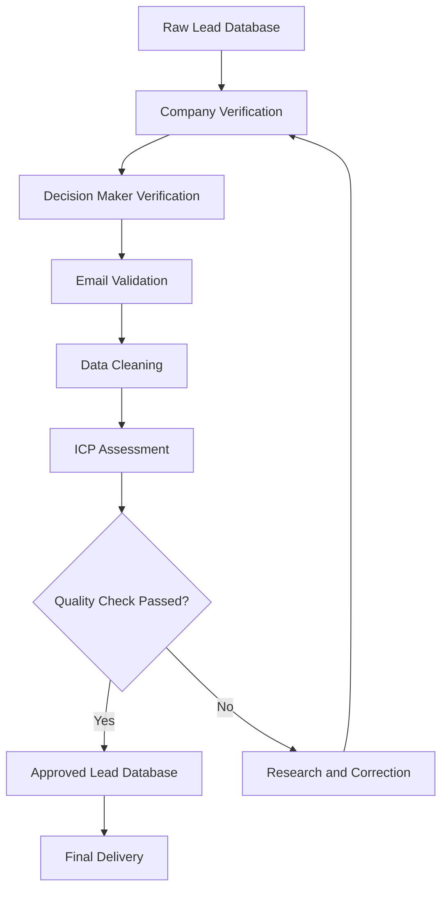

# B2B Lead Generation — Quality Assurance Framework

### Data Accuracy | Research Integrity | Delivery Standards

Developed by Sree Polash Kumar Das  
Co-Founder & COO — Synthetic Alliance

---

## 01. Quality Assurance Objective

This framework establishes a structured process for reviewing B2B lead databases before client delivery, focusing on accuracy, relevance, completeness, and responsible data management.

## 02. Company Verification

- [ ] Company name is accurate
- [ ] Official website is accessible
- [ ] Company industry matches the ICP
- [ ] Company size meets requirements
- [ ] Geographic location is accurate
- [ ] Business is currently operational
- [ ] Company information has supporting sources

## 03. Decision Maker Verification

- [ ] Contact name is accurate
- [ ] Job title matches campaign requirements
- [ ] Current employment has been checked
- [ ] Professional profile URL is correct
- [ ] Decision maker relevance is confirmed
- [ ] Contact information has supporting sources

## 04. Business Email Validation

- [ ] Email syntax is valid
- [ ] Email domain matches the company
- [ ] Domain mail records have been checked
- [ ] Verification status is documented
- [ ] Invalid emails are excluded
- [ ] Catch-all and unknown emails are flagged
- [ ] Verification date is recorded

Email verification does not guarantee deliverability.

## 05. Data Cleaning

- [ ] Duplicate records are removed
- [ ] Company names are standardized
- [ ] Name formatting is consistent
- [ ] Website URLs are correctly formatted
- [ ] Country names are standardized
- [ ] Missing information is identified
- [ ] Unverified information is clearly labeled
- [ ] Spreadsheet column structure is consistent

## 06. Quality Assessment Metrics

| Metric | Proposed Target |
|---|---:|
| ICP Relevance | 95% or above |
| Required Field Completeness | 95% or above |
| Duplicate Records | 0% |
| Invalid Emails in Approved List | 0% |
| Research Source Documentation | 100% |
| Privacy Compliance Review | Required |

These are proposed operational targets, not guaranteed
results or previously achieved performance statistics.

## 07. Quality Measurement

### ICP Relevance

ICP Relevance (%) =
(ICP-matched leads / Total reviewed leads) × 100

### Data Completeness

Data Completeness (%) =
(Completed required fields / Total required fields) × 100

### Duplicate Rate

Duplicate Rate (%) =
(Duplicate records / Total records) × 100

### Email Verification Rate

Email Verification Rate (%) =
(Verified emails / Total emails reviewed) × 100

## 08. Lead Status Classification

| Status | Description |
|---|---|
| Approved | Meets defined quality requirements |
| Needs Review | Requires additional research |
| Unverified | Information could not be confirmed |
| Rejected | Does not meet project requirements |
| Duplicate | Repeated record identified |

## 09. Quality Assurance Workflow

## 10. Client Delivery Checklist

- [ ] Required lead quantity reviewed
- [ ] Client instructions followed
- [ ] Required data fields completed
- [ ] Quality metrics calculated
- [ ] Verification limitations disclosed
- [ ] Final CSV or Excel file prepared
- [ ] Delivery file reviewed
- [ ] Confidential information protected

## 11. Data Privacy and Research Ethics

- Respect applicable privacy laws.
- Follow platform terms of service.
- Collect only necessary business information.
- Avoid publishing confidential client databases.
- Respect applicable opt-out and deletion requests.
- Clearly distinguish synthetic data from real research.
- Never fabricate verification results.

## 12. Final Review Report

| Review Information | Details |
|---|---|
| Project Name | To be specified |
| Total Leads | Pending |
| Approved Leads | Pending |
| Rejected Leads | Pending |
| Duplicate Records | Pending |
| ICP Relevance | Pending |
| Data Completeness | Pending |
| Email Verification Rate | Pending |
| Reviewed By | To be specified |
| Review Date | To be specified |
| Final Status | Pending |

---

## Professional Information

**Sree Polash Kumar Das**

B2B Lead Generation Specialist  
Co-Founder & Chief Operating Officer  
Synthetic Alliance

[Portfolio](https://polashkumar.sites.bd/) |
[LinkedIn](https://www.linkedin.com/in/sree-polash-kumar-das/)

---

**SYNTHETIC ALLIANCE**

YOUR GROWTH IS OUR PURPOSE.
